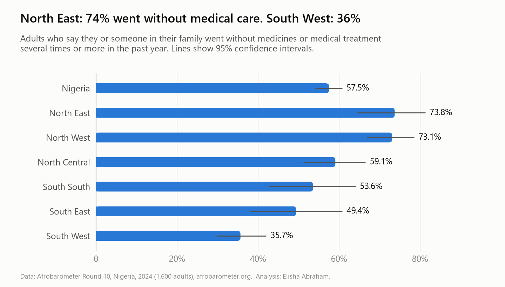
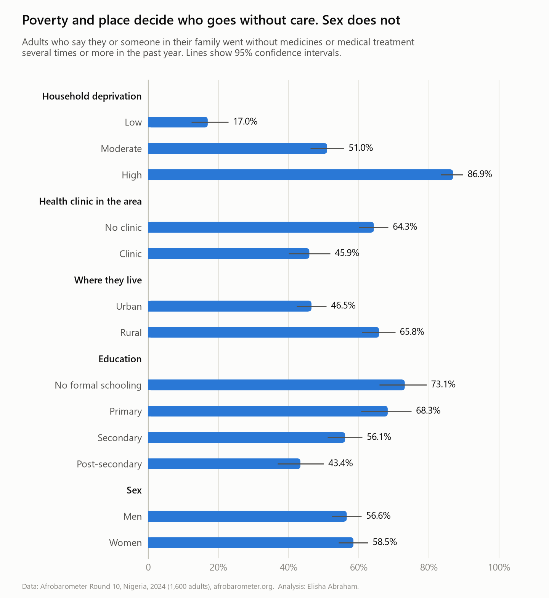
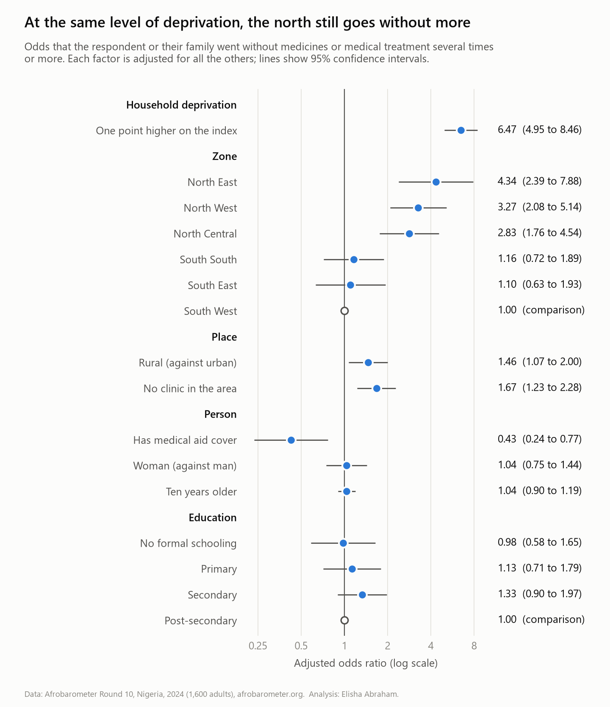
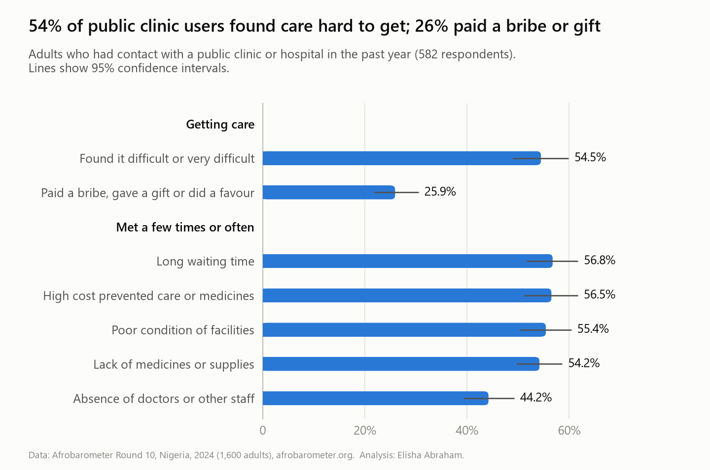

# Going without medical care in Nigeria

**Who goes without medical care in Nigeria, and what happens to those who reach a public clinic?**

A survey analysis in SPSS of the 2024 Afrobarometer survey of Nigeria (1,600 adults): missing values declared, the sampling clusters rebuilt and verified, every estimate computed for the sample design, a deprivation index validated, a design-based logistic model, and all of it written as syntax, exported to files and cross-checked in Python.

`IBM SPSS Statistics 27` · `Complex Samples` · `syntax and macros` · `survey weights and design effects` · `scale reliability` · `logistic regression` · `Python cross-check`

## The short answer

57.5% of Nigerian adults (95% CI 54.2 to 60.8) say they or someone in their family went without medicines or medical treatment several times or more in the past year.

1. **It follows poverty more than anything else.** 17.0% of adults in households with low deprivation went without, against 86.9% where deprivation is high. Other things equal, each point on the 0-to-4 deprivation index multiplies the odds by 6.5.
2. **It follows place, even at the same level of poverty.** 73.8% in the North East and 73.1% in the North West, against 35.7% in the South West. After adjusting for deprivation and everything else in the model, the three northern zones still have about three to four times the odds of the South West.
3. **A clinic nearby helps.** 64.3% went without where the neighbourhood has no health clinic and 45.9% where it has one. The gap survives adjustment (odds ratio 1.67), and living in a rural area adds to it (1.46).
4. **It does not follow sex or age.** Men 56.6%, women 58.5%, and no pattern across age groups.
5. **Education matters only through poverty.** The gap between no formal schooling (73.1%) and post-secondary education (43.4%) disappears once deprivation is in the model.
6. **Medical aid cover is rare and protective.** 7.1% of adults have any cover. Those who do have less than half the odds of going without (0.43).
7. **Reaching a public clinic is not the end of the problem.** A third of adults (34.7%) had contact with a public clinic or hospital in the past year. Of those, 54.5% found it difficult to get the care they needed and 25.9% paid a bribe, gave a gift or did a favour to get it.

## What this points to

| Finding | What it suggests |
|---|---|
| Deprivation is the strongest factor, 7.1% have cover, and 46.8% worry a lot about being unable to get or afford care. | The first barrier is money. Financial protection reaches very few of the people who need it. |
| The north goes without more than the south at the same level of deprivation. | Poverty does not explain the northern gap. Supply of services is the next place to look. |
| A clinic in the neighbourhood lowers the odds, in town and country alike. | Where primary care is sited matters, separately from who can pay. |
| Among clinic users, bribes rise from 13.4% in the least deprived households to 33.1% in the most deprived, and are no different between urban and rural areas. | Informal payments fall hardest on those least able to pay. |
| 63.9% agree that government should ensure health care for all, even if taxes rise. | There is public support for paying for it. |

These are associations in a single survey. The limits are set out below.

## Findings in detail

### The north goes without most

<picture>
  <source media="(prefers-color-scheme: dark)" srcset="figures/01_without_care_by_zone_dark.png">
  
</picture>

The question asks how often "you or anyone in your family" went without medicines or medical treatment. Across all adults, 18.2% said never, 24.3% once or twice, 31.1% several times, 18.5% many times and 7.9% always. The analysis counts "several times" or more.

The intervals are wide for single zones (about 6 to 11 points either side), because each zone has 180 to 400 respondents in 23 to 50 clusters. The contrast between the two northern zones and the South West is far outside that margin.

### Poverty and place, not sex

<picture>
  <source media="(prefers-color-scheme: dark)" srcset="figures/02_without_care_by_group_dark.png">
  
</picture>

Every difference in the chart except sex is statistically clear on the Rao-Scott adjusted chi-square test (p < 0.001 for deprivation, zone, urban or rural, clinic and education). Sex is not (p = 0.48), and neither is age group (p = 0.59).

One result runs against intuition: people who had contact with a public clinic were more likely to have gone without care (68.7%) than people who had not (51.6%). Contact with a clinic is a sign of need, not a sign of access.

### What still matters when everything is taken together

<picture>
  <source media="(prefers-color-scheme: dark)" srcset="figures/03_adjusted_odds_ratios_dark.png">
  
</picture>

Two design-based logistic regressions were fitted. The first holds place and person only. The second adds the deprivation index, which shows how much of each gap is a gap in poverty.

| Odds ratio (95% CI) | Model 1: place and person | Model 2: plus deprivation |
|---|---|---|
| Deprivation index, per point | | 6.47 (4.95 to 8.46) |
| North East (against South West) | 4.47 (2.59 to 7.69) | 4.34 (2.39 to 7.88) |
| North West | 3.31 (2.21 to 4.95) | 3.27 (2.08 to 5.14) |
| North Central | 2.60 (1.71 to 3.95) | 2.83 (1.76 to 4.54) |
| South South | 1.92 (1.26 to 2.92) | 1.16 (0.72 to 1.89) |
| South East | 1.38 (0.85 to 2.26) | 1.10 (0.63 to 1.93) |
| Rural (against urban) | 1.35 (1.04 to 1.77) | 1.46 (1.07 to 2.00) |
| No clinic in the area | 1.70 (1.29 to 2.23) | 1.67 (1.23 to 2.28) |
| Has medical aid cover | 0.39 (0.21 to 0.71) | 0.43 (0.24 to 0.77) |
| No formal schooling (against post-secondary) | 1.47 (0.93 to 2.32) | 0.98 (0.58 to 1.65) |
| Primary | 1.87 (1.22 to 2.88) | 1.13 (0.71 to 1.79) |
| Secondary | 1.53 (1.07 to 2.19) | 1.33 (0.90 to 1.97) |
| Woman (against man) | 1.01 (0.77 to 1.32) | 1.04 (0.75 to 1.44) |
| Ten years older | 1.10 (0.98 to 1.23) | 1.04 (0.90 to 1.19) |
| Nagelkerke R² | 0.17 | 0.48 |

Adding deprivation does three things. It explains the education gap entirely (education as a whole: p = 0.018 in Model 1, p = 0.40 in Model 2). It explains the difference between the South South and the South West. It leaves the northern zones, the rural effect and the clinic effect where they were. Model 1 uses the 1,582 respondents with complete answers and Model 2 the 1,573 who also answered all four deprivation questions.

### At the public clinic

<picture>
  <source media="(prefers-color-scheme: dark)" srcset="figures/04_clinic_experience_dark.png">
  
</picture>

Difficulty and informal payments both rise with deprivation. Among clinic users in households with low, moderate and high deprivation, 36.3%, 49.5% and 64.0% found care difficult to get (p < 0.001), and 13.4%, 21.5% and 33.1% paid a bribe, gave a gift or did a favour (p = 0.003). Neither differs between urban and rural areas (54.5% against 54.5%, and 25.4% against 26.2%).

## How the survey design was handled

This is where most of the work went, and it is the part most often skipped.

| What the published file looked like | What I did |
|---|---|
| "Refused", "don't know" and "not applicable" are stored as ordinary numbers (8, 9, 7). | Declared them as missing, question by question. Left alone, a "don't know" would enter a 0-to-4 scale as a 9. |
| The file arrives with weighting switched on. | Switched it off, so that counts are counts, and applied the weight in one place only: the analysis plan. |
| There is no cluster number, although eight people were interviewed in each of 200 enumeration areas and standard errors depend on it. | Rebuilt the clusters. Respondents who share the same state, urban or rural status, local government area, area-level weight and all 22 field observations of the area were interviewed in the same area. |
| Nothing confirms the rebuilt clusters are right. | Checked them against three facts not used to build them. All 200 hold exactly eight respondents. 199 were worked by exactly four interviewers. 196 hold four men and four women, as the fieldwork rules require. |
| The survey was stratified by state and urban or rural, but 22 of those 73 strata hold a single cluster, and a variance cannot be estimated from one. | Used twelve broader strata (zone by urban or rural), each with 8 to 34 clusters. |
| The weights add up to the sample size, not to the population. | Measured design effects against a simple random sample drawn with replacement. The other setting reads the weights as a population of 1,600 and reports design effects in the thousands. |
| The clinic questions were asked only of people who had contact with a clinic. | Kept every respondent in the design and analysed the clinic users as a subpopulation. Deleting the others first would discard part of the design. |

The design matters to the answer. The headline figure has a design effect of 1.85: its standard error is 1.69 points, where the textbook formula for a simple random sample would say 1.24. For a variable shared by everyone in a cluster, such as whether the area has a clinic, the design effect is 8.4.

### The deprivation index

The index is the mean of four questions on how often the household went without enough food, clean water, cooking fuel and a cash income, each scored 0 (never) to 4 (always). Medical care is left out on purpose: it is the outcome, and an index that contained it would predict itself.

- Cronbach's alpha is 0.69 for the four items, just under the usual 0.70 and reasonable for so short a scale. With the medical care item added back (Afrobarometer's five-item Lived Poverty Index) it is 0.77.
- One principal component has an eigenvalue above 1. It carries 52% of the variance, and every item loads between 0.70 and 0.75 on it. KMO is 0.72.
- The weighted mean is 1.84. It differs by zone (1.60 in the South West to 2.03 in the North West, p < 0.001) and between urban (1.74) and rural areas (1.92, p = 0.006).

## How the work was done

| Step | Script | What it does |
|---|---|---|
| 0 | [`syntax/00_run_all.sps`](syntax/00_run_all.sps) | Runs everything below, in order. |
| | [`syntax/macros.sps`](syntax/macros.sps) | Reusable macros: save any output table as a CSV file; design-based percentages of an outcome across any list of groupings. |
| 1 | [`syntax/01_prepare_data.sps`](syntax/01_prepare_data.sps) | Missing values, recodes and labels, the deprivation index, the rebuilt clusters and their checks. |
| 2 | [`syntax/02_survey_design.sps`](syntax/02_survey_design.sps) | The Complex Samples analysis plan: strata, clusters, weight. |
| 3 | [`syntax/03_scales.sps`](syntax/03_scales.sps) | Reliability, principal components, and design-based means of the index by zone and by urban or rural (`RELIABILITY`, `FACTOR`, `CSDESCRIPTIVES`, `CSGLM`). |
| 4 | [`syntax/04_prevalence.sps`](syntax/04_prevalence.sps) | Headline percentages and going without care by place and person, with Rao-Scott tests (`CSTABULATE`). |
| 5 | [`syntax/05_model.sps`](syntax/05_model.sps) | Two design-based logistic regressions (`CSLOGISTIC`). |
| 6 | [`syntax/06_clinic_experience.sps`](syntax/06_clinic_experience.sps) | Experience of public clinic users, as a subpopulation. |

Every table that feeds a number in this README is saved by the syntax itself as a CSV file in [`results/`](results), so results can be compared between runs and checked from outside SPSS.

### How I know the numbers are right

- **Two independent implementations.** [`scripts/cross_check.py`](scripts/cross_check.py) starts again from the published file and rebuilds the variables, the clusters, the Taylor-linearised standard errors, the confidence intervals, the design effects, the reliability and component statistics and both logistic regressions in numpy and pandas. It compares 1,297 figures with SPSS. All 1,297 agree to six significant figures.
- **The clusters are checked, not assumed** (table above).
- **Charts cannot drift from the data.** Chart titles take their numbers from the result files, and the claim in each title is tested by the script before the chart is drawn.

## Limits of this analysis

- **Answers are reports, not records.** "Went without medicines or medical treatment" is what the respondent says about their family. It does not measure how much care was needed.
- **The deprivation questions and the outcome sit in the same block of the questionnaire** and share an answer scale. People who answer one item high tend to answer the next one high for reasons of style as well as substance, which may inflate the deprivation odds ratio. The place effects do not have this problem.
- **One survey, one moment.** These are associations. The model does not show that a new clinic or an insurance card would change what a household does.
- **"Clinic in the area" is what the field team saw** in the enumeration area. It says nothing about the clinic's quality, cost or ownership.
- **Twelve strata stand in for 73.** Collapsing strata was necessary to estimate variances at all, and tends to make standard errors slightly larger, not smaller.
- **Small groups have wide intervals.** Only 102 respondents have medical aid cover and 582 had contact with a public clinic. Zone-level figures for clinic users are too imprecise to rank.
- **Public facilities only.** The clinic questions do not cover private providers, pharmacies or traditional healers.

## Run it yourself

Requirements: IBM SPSS Statistics 27 or later with the Complex Samples module, and Python 3.10 or later.

```bash
pip install -r requirements.txt

# downloads the survey file (1.7 MB) from afrobarometer.org into data/raw/
python scripts/01_download_data.py

# runs all the SPSS syntax without opening SPSS (about 10 seconds)
"C:\Program Files\IBM\SPSS\Statistics\27\statisticspython3.bat" scripts/run_spss.py

python -I scripts/cross_check.py
python scripts/make_figures.py
```

To run it from the SPSS window instead, open `syntax/00_run_all.sps` and follow the two lines at the top.

The data file is not stored in this repository. Afrobarometer data are free to use but protected by copyright, so the download script fetches the file from the source.

## Repository layout

```
data/         data notes; data/raw/ is filled by the download script
syntax/       the SPSS syntax: one master file, one macro file, six steps
scripts/      download, run-SPSS, cross-check and chart scripts
results/      CSV tables exported by the syntax
figures/      charts, in light and dark variants
```

## Data and licence

Data: Afrobarometer Data, Nigeria, Round 10, 2024, available at http://www.afrobarometer.org. Fieldwork ran from 19 June to 17 July 2024 with 1,600 adults. The data are copyright Afrobarometer and are used here under its data usage policy, which asks users to acknowledge the source.

Code in this repository: MIT licence.

## Author

**Elisha Abraham** is a healthcare and research data analyst with clinical training in nursing.
[LinkedIn](https://www.linkedin.com/in/elisha-abraham-a90569352) · [GitHub](https://github.com/elisha-abraham) · elishaabraham25@gmail.com
